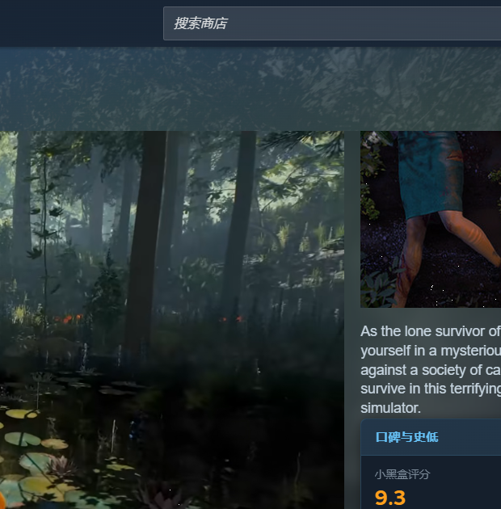

# Steam 游戏口碑与史低

> 为 Steam 商店页补充小黑盒评分、Steam 全语言好评率、实时在线人数、国区史低价格与中文类型标签。国内直连，无需代理。



## 功能

| 模块 | 数据源 | 说明 |
|---|---|---|
| 小黑盒评分 | 小黑盒 | 中文社区 10 分制评分 + 五星分布 |
| Steam 好评率 | Steam 官方 | 全语言好评率百分比 |
| 实时在线 | Steam 官方 | 当前正在游玩的人数 |
| 国区史低价格 | IsThereAnyDeal | 人民币史低、折扣、原价 |
| 中文类型标签 | 小黑盒 | 游戏类型（中文） |

## 安装

### 方式一：Chrome 扩展（需 Extendium）

1. 确保已安装 [Millennium](https://github.com/SteamClientHomebrew/Millennium) 和 [Extendium](https://steambrew.app/)
2. 下载本仓库并解压到 `Steam\millennium\plugins\extendium\user-extensions\steam-game-panel\`
3. 以 `-dev` 参数启动 Steam
4. 打开 `chrome://extensions`（通过 Extendium 的扩展管理器）
5. 开启「开发者模式」→「加载已解压的扩展程序」→ 选择 `steam-game-panel` 目录

### 方式二：手动加载

1. 在 Steam 内置浏览器中打开 `chrome://extensions`
2. 开启「开发者模式」
3. 点击「加载已解压的扩展程序」
4. 选择本仓库根目录（含 `manifest.json` 的目录）

## 配置

点击工具栏的扩展图标（徽章图标），在弹窗中填入 **ITAD API Key**：

1. 访问 [isthereanydeal.com/apps](https://isthereanydeal.com/apps) 注册并创建应用
2. 在「API Keys」区域获取 Key（32 位十六进制）
3. 粘贴到弹窗输入框，点击「保存」

未配置 Key 时，史低价格一栏显示 `—`。

## 布局

```
┌──────────────────────────────────┐
│ 口碑与史低                    森林 │
├──────────────┬───────────────────┤
│ 小黑盒评分    │ Steam 好评率       │
│ 9.3          │ 93%               │
│ 2.3 万人评分  │ 特别好评 · 7 万篇   │
├──────────────┼───────────────────┤
│ 实时在线      │ 史低价格 · Steam   │
│ 3,091        │ ¥7                │
│ Steam 官方    │ -90% · 原价 ¥70    │
├──────────────────────────────────┤
│ [开放世界生存制作][生存][开放世界]…  │
├──────────────────────────────────┤
│ ● 小黑盒 · Steam · ITAD           │
└──────────────────────────────────┘
```

## 技术架构

```
background.js      数据聚合（小黑盒 / Steam / ITAD）+ 10 分钟缓存
content-bridge.js  storage → DOM 属性中转（绕过 chrome.runtime 限制）
content-main.js    2×2 布局渲染
popup.html/js      API Key 配置 + 清缓存
```

### 数据流

```
小黑盒 API ─┐
Steam API  ─┼─→ background.js ─→ chrome.storage ─→ content-bridge.js ─→ content-main.js ─→ DOM
ITAD API   ─┘
```

## 限流

| 源 | 限制 |
|---|---|
| 小黑盒 | 无明确限制 |
| Steam 官方 | 无明确限制 |
| ITAD | 1000 次 / 5 分钟 |

## 文件结构

```
steam-game-panel/
├── manifest.json          MV3 扩展清单
├── background.js          Service Worker（数据聚合）
├── content-bridge.js      ISOLATED 世界（storage 中转）
├── content-main.js        MAIN 世界（UI 渲染）
├── popup.html/js          扩展弹窗（API Key 配置）
├── _locales/zh_CN/        中文语言包
├── icons/                 图标 16/48/128
└── images/panel-demo.png  示例图
```

## 免责声明

本扩展为非官方工具，与 Valve Corporation、小黑盒、IsThereAnyDeal 无关。数据仅供参考，实际以 Steam 商店为准。

## License

MIT
